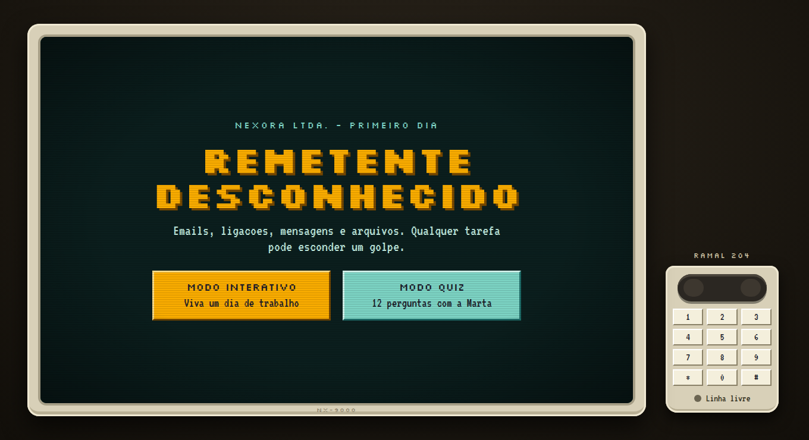
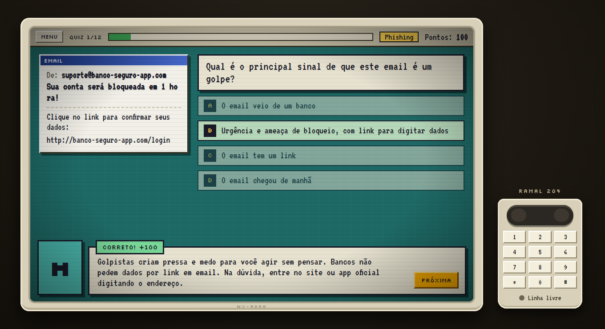
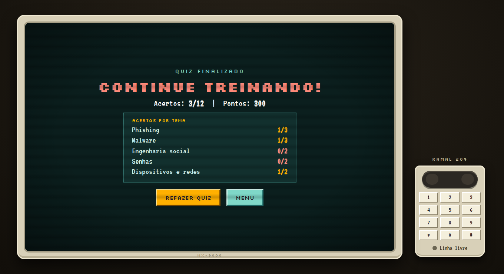
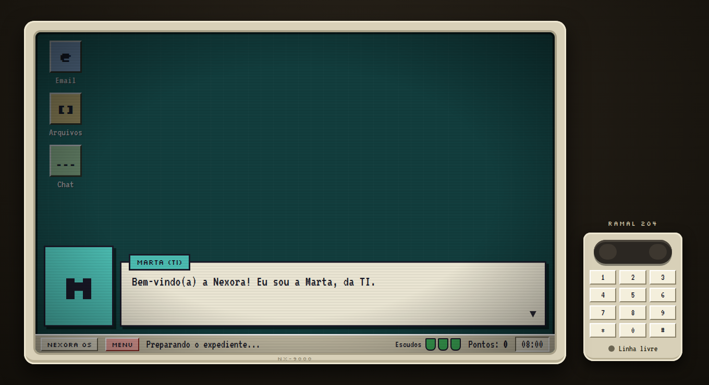
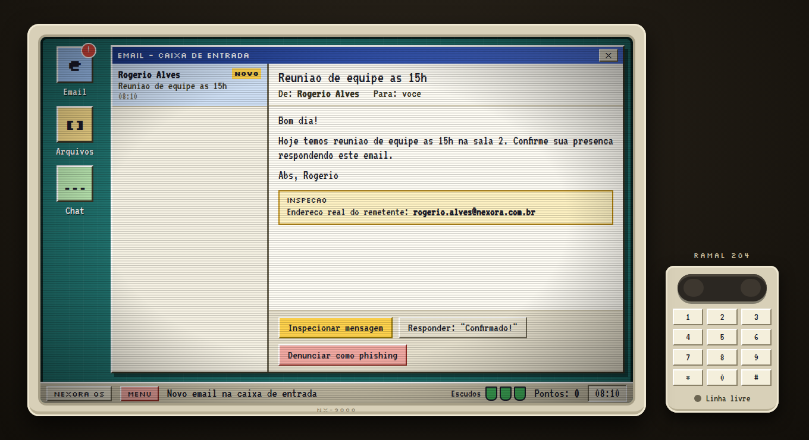
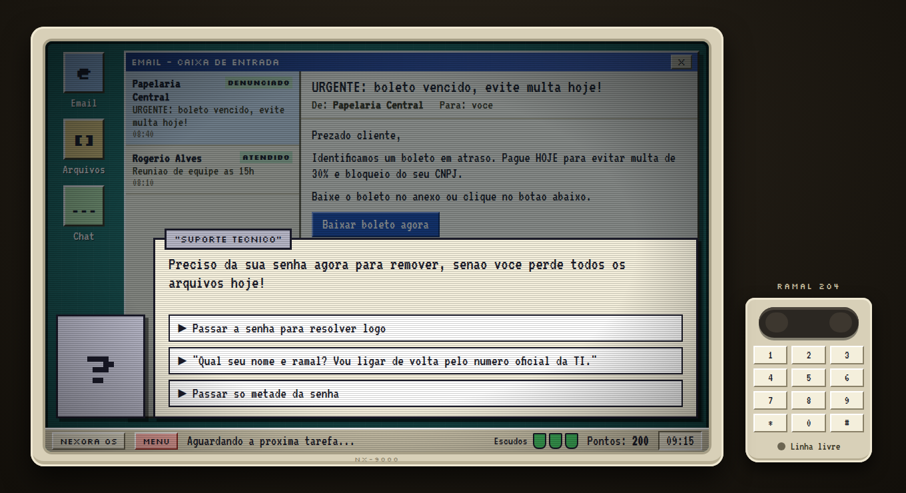
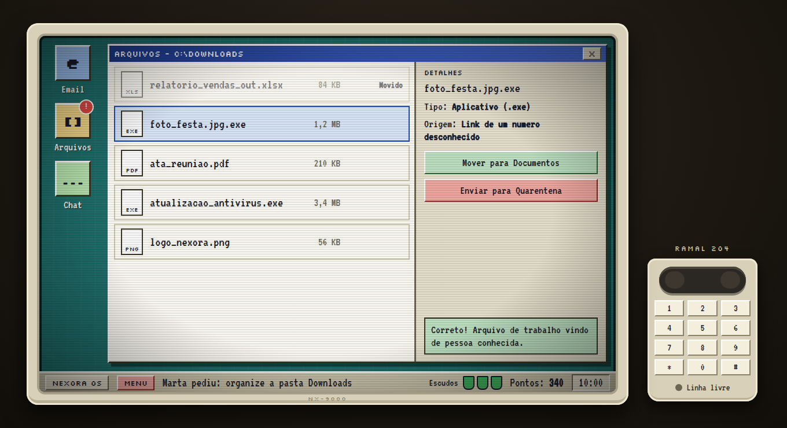
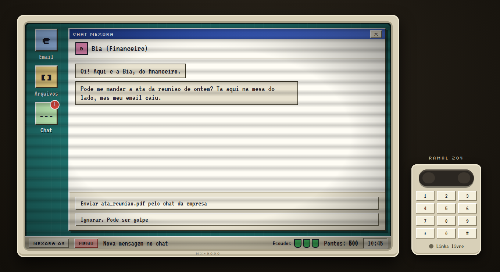
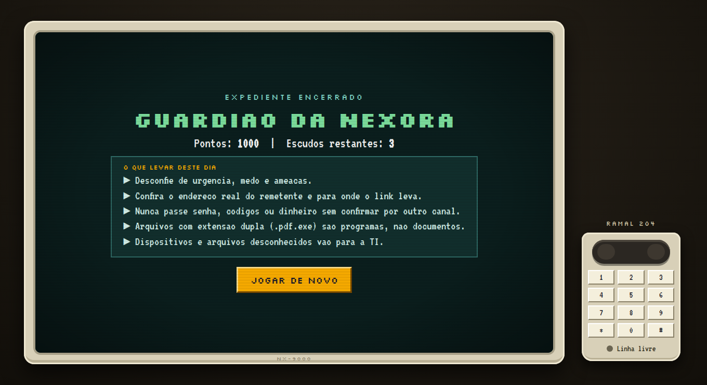

# Remetente Desconhecido

> Proposta de jogo interativo para a disciplina de Multimídia Educacional.

**Autores:** André Luiz dos Santos Cesário Oliveira, Dimitri Stocker Bungart, Eloisa Pereira Mendes, Gabriel Rodrigues Santos, Luiz Felipe Pereira dos Santos e Sara Freitas da Rocha.



## Objetivo

Ensinar, de maneira interativa, como ataques cibernéticos são iniciados, como afetam os sistemas atingidos e, principalmente, como os usuários podem se proteger das ameaças. Com isso, os jogadores serão capazes de identificar ameaças e escolher formas adequadas de proteção, desenvolvendo um senso crítico mais apurado em relação à navegação na Internet.

## Público-alvo

Estudantes do 7º ao 9º ano do ensino fundamental (12 a 15 anos) que desejam aprender mais sobre cibersegurança e maneiras de se protegerem na Internet.

## Habilidades da BNCC atendidas

| Habilidade | Ano | Descrição | Onde aparece |
| --- | --- | --- | --- |
| EF07CO07 | 7º | Identificar problemas de segurança cibernética e experimentar formas de proteção | **Modo Quiz**: o jogador analisa um enunciado com a descrição de um problema e escolhe a alternativa mais adequada |
| EF09CO04 | 9º | Compreender o funcionamento de malwares e outros ataques cibernéticos | **Modo Tema**: o jogador tem contato com malwares, phishing e outros ataques, entendendo na prática como afetam um sistema |

## Descrição do jogo

Experiência educativa no estilo *point and click*, com conceitos básicos de cibersegurança de forma lúdica, interativa e acessível. A experiência é em primeira pessoa, simulando o uso de um computador. No início, o jogador escolhe entre dois modos de aprendizagem, para adotar a abordagem que combina com suas preferências.

### Modo Quiz

O jogador responde a perguntas sobre segurança digital: vírus, phishing, criação de senhas seguras e privacidade on-line. Uma situação é apresentada e ele escolhe a alternativa que julgar correta.

- O feedback é imediato.
- Cada resposta correta rende pontos.
- Ao errar, o jogo mostra a resposta correta e explica o raciocínio, para que o jogador entenda o problema antes de prosseguir.
- Ao final, a pontuação é exibida e o jogador avalia seu desempenho.

| Pergunta com cenário e feedback | Resultado por tema |
| --- | --- |
|  |  |

### Modo Tema

O jogador seleciona um assunto específico para estudar. Os conteúdos são mais detalhados e explicativos, com exemplos visuais para fixar o tema e uma pequena atividade prática, para uma compreensão mais sólida dos principais conceitos.

Ao concluir atividades e resolver desafios corretamente, o jogador acumula pontos, avança de nível e desbloqueia novos conteúdos.

### Modo Interativo ("um dia de trabalho")

Hoje, a parte prática do jogo é um dia de trabalho na empresa fictícia Nexora. O jogador é um funcionário no primeiro dia e cumpre tarefas (emails, ligações, mensagens e arquivos). Qualquer tarefa pode esconder malware ou engenharia social, e cada erro grave custa um escudo.

| Introdução com a Marta (TI) | Email com inspeção da mensagem |
| --- | --- |
|  |  |

| Ligação de golpista (telefone fixo) | Organizar a pasta Downloads |
| --- | --- |
|  |  |

| Chat com pedido suspeito | Fim do expediente |
| --- | --- |
|  |  |

## Estado atual da implementação

| Item da proposta | Situação |
| --- | --- |
| Modo Quiz (12 perguntas, feedback, pontuação, resultado por tema) | Implementado |
| Atividade prática em primeira pessoa (emails, telefone, chat, arquivos) | Implementado como "Modo Interativo" |
| Modo Tema (conteúdo por assunto, níveis e desbloqueios) | A fazer |
| Interface responsiva (computador, celular e tablet) | A fazer: o monitor tem tamanho fixo (1040×660) |

## Tecnologias

A proposta prevê HTML, CSS e JavaScript. A implementação usa o ecossistema web moderno sobre essas três bases:

- **HTML / React:** estrutura das telas, com textos legíveis, botões grandes e boa didática.
- **CSS / Tailwind CSS:** estilo temático de tecnologia (visual retrô de computador) para imersão e realismo, preparando o jogador para uma situação real.
- **JavaScript:** lógica do jogo, interações, pontuação, progressão e feedback ao jogador.
- **Vite:** servidor de desenvolvimento e build.

## Resultados esperados

Espera-se que o aluno consiga:

- Reconhecer diferentes tipos de ameaças presentes no ambiente digital;
- Compreender conceitos básicos de malwares, phishing e segurança de contas;
- Identificar situações potencialmente perigosas durante a navegação na Internet;
- Conhecer práticas de proteção de dados e informações pessoais;
- Desenvolver maior atenção e senso crítico diante de situações de risco on-line.

## Considerações finais

O jogo foca em uma experiência educativa, apresentando conceitos de forma prática para que os jogadores reconheçam ameaças e compreendam formas de proteção em ambientes digitais.

A aplicação deve ser responsiva e utilizável em computadores, celulares e tablets, com interface clara e navegação simples. A expectativa é que seja uma ferramenta complementar em aulas de tecnologia, informática ou segurança digital, e que também possa ser usada individualmente pelos estudantes para reforçar o conteúdo visto em sala.

---

## Desenvolvimento

### Rodar

```bash
npm install
npm run dev      # servidor de desenvolvimento
npm run build    # gera dist/
npm run preview  # serve o dist/
```

Requer Node 18+ (Vite 5 / Tailwind 3.4).

### Estrutura

```
index.html             entrada do Vite
tailwind.config.js     cores, fontes e animações do tema retrô
docs/screenshots/      imagens usadas neste README
src/
  main.jsx             monta o <Game />
  index.css            Tailwind + classes .bevel / .btn-amber / .btn-mint
  data/                TODO o conteúdo do jogo, em JSON
    config.json          vidas, velocidade do texto, efeito CRT
    characters.json      personagens (nome, cor, inicial)
    dialogue/intro.json  diálogo de abertura
    events/              um arquivo por tarefa do dia (emails, telefone, chat, cena)
                         textos, respostas certas/erradas e feedback da Marta
    files.json           arquivos da pasta Downloads
    quiz/questions.json  perguntas, alternativas, resposta e explicação
    texts/game.json      textos de interface, ranks, lições finais
  game/                lógica (sem JSX), um módulo por área
    data.js              carrega os JSONs
    Game.jsx             componente principal (estado + junta os módulos)
    dialogue.js          caixa de diálogo
    flow.js              fluxo do jogo e respostas
    files-app.js         app de arquivos
    quiz.js              modo quiz
    render.js            valores usados pelos componentes
  components/          interface
    Monitor, Phone, DialogBox, Taskbar, Toast, DesktopIcons, Crt
    screens/             Play, Title, End, Quiz, QuizEnd
    apps/                AppWindow, EmailApp, FilesApp, ChatApp
```

### Como alterar

- Novo evento/pergunta/texto: edite ou adicione um JSON em `src/data/`. Os eventos rodam em ordem alfabética do nome do arquivo (por isso `01-`, `02-`...).
- Visual: componentes em `src/components/` com classes Tailwind; cores e fontes em `tailwind.config.js`.
- O Preflight do Tailwind está desligado de propósito para manter o visual original.
